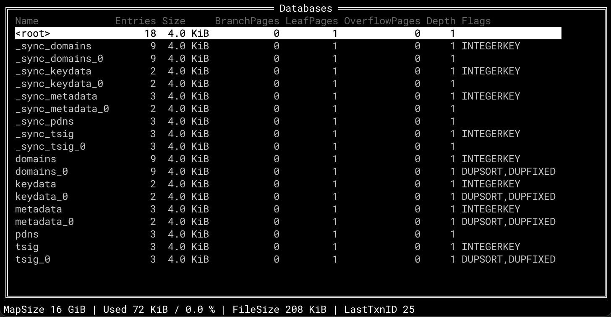
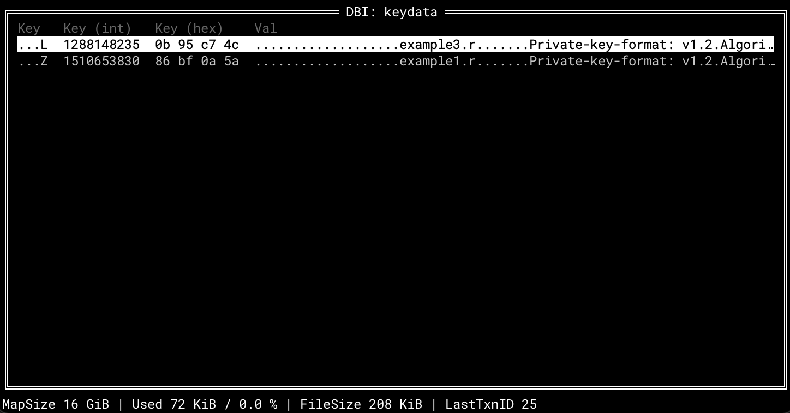
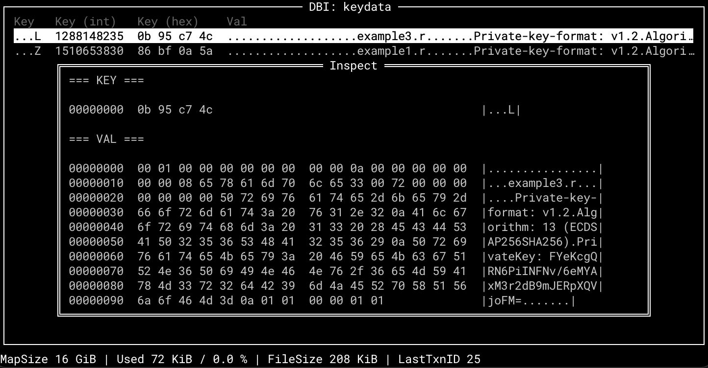

# lmdbnav

A terminal UI to inspect LMDB database files.

This is a tool that we use internally to debug LMDB databases. We decided to open source it, since it can be useful to others.

Contributions are welcome.

## Installation

lmdbnav is written in Go and embeds the LMDB database engine (written in C),
so building it requires two things:

1. **Go 1.21 or newer.** Download it from <https://go.dev/dl/>, or use a
   package manager: `brew install go` (macOS) or `sudo apt install golang`
   (Debian/Ubuntu). Verify with `go version`.
2. **A C compiler.** On macOS run `xcode-select --install`, on Debian/Ubuntu
   `sudo apt install build-essential`, on Fedora `sudo dnf install gcc`.

Then this single command downloads, builds and installs lmdbnav:

```
$ go install github.com/PowerDNS/lmdbnav/cmd/lmdbnav@latest
```

The binary is installed as `~/go/bin/lmdbnav`. Either add `~/go/bin` to your
`PATH`, run it by its full path, or point `GOBIN` at a directory of your
choice, e.g.:

```
$ GOBIN=/usr/local/bin go install github.com/PowerDNS/lmdbnav/cmd/lmdbnav@latest
```

From a local source checkout, use the same commands with the package path
replaced by `./cmd/lmdbnav`.

> **Note:** while lmdbnav depends on an unreleased lmdb-go v2 through a
> `replace` directive, the remote `go install` form above does not work.
> Until lmdb-go v2 is released, clone this repository and install from the
> local source checkout instead.

## Usage

```
$ lmdbnav /path/to/lmdb
```

To enable support for [Lightning Stream](https://github.com/PowerDNS/lmdbnav) headers:

```
$ lmdbnav --ls /path/to/lmdb
```

Key bindings:

- Arrow keys are used for navigation
- `Enter` dives into a subview
- `Esc` returns to the previous screen
- `R` or `r` refreshes the view from the LMDB
- `[` and `]` jump 1000 rows
- `{` and `}` jump 10000 rows
- `Home` and `End` navigate to the beginning and end

## Example screenshots






